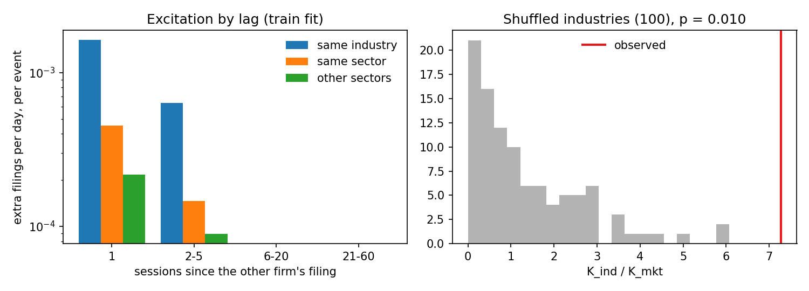

# disclosure-contagion

**When one S&P 500 company files unscheduled news with the SEC, do its industry peers follow, and does that help
forecast their volatility?**

A discrete-time Hawkes model fitted to 26,835 unscheduled 8-K filings by 673 S&P 500 companies, 2016–2026,
pre-registered before any model was fitted ([PREREGISTRATION.md](PREREGISTRATION.md); the commit history shows the
order).

## Answer

| | Result | Verdict |
|---|---|---|
| **A. Contagion** | In train, a filing by a same-industry peer raises a company's filing rate **7.3x more** than a filing by an unrelated company, more than in all 100 shuffled-industry controls (p = 0.010). The effect is gone after 5 trading days. Out of sample (2022–2026) it barely improves predictions (log-likelihood +2.8, t = 0.5). | **Inconclusive** |
| **B. Volatility** | Adding peer filing intensity to a HAR model does not improve next-week volatility forecasts: test MSE is 0.03% *worse* (t = −5.2). The firm's own filing intensity doesn't help either (+0.003%, t = −0.4). | **Refuted** |

In plain terms, the industry pattern is real in the data it was fitted on and is not explained by chance groupings or
the calendar, but it is small. The day after a peer files, a company's chance of filing is about 10% above its normal
rate; after an unrelated company files, about 1%. On average one peer filing produces 0.004 extra filings, so it takes
about 240 peer filings to set off one more. That is too little to predict filings reliably in later years, and too
little to move volatility forecasts.



*Left: extra filings per day at a company, per filing by another company, by lag (6–60 sessions are zero). Right: the
same-industry / other-sector ratio for 100 random industry assignments of the same sizes (grey) and the real one (red).*

## Data

- **Firms:** S&P 500 members by month (point in time), one firm per CIK; 654 have a Sharadar industry (120 industries,
  11 sectors).
- **Events:** original 8-Ks from EDGAR containing an unscheduled item (1.01–1.05, 2.01, 2.03–2.06, 3.01, 3.03, 4.01,
  4.02, 5.01, 5.02) and no earnings item (2.02). Each is dated to the trading session it became public in (after
  16:00 ET counts as the next session). The list is in [data/unscheduled_8k.csv.gz](data/unscheduled_8k.csv.gz).
- **Prices:** Sharadar daily open, high, low and close (paid; not included).
- **Split:** train 2017–2021 (10,269 filings, 607k firm-days), test 2022 to June 2026 (7,907 filings, 524k firm-days).

## Method

**Model A.** A company's daily filing count is Poisson with rate

```
lam = mu_firm + sum over lags (1, 2-5, 6-20, 21-60 sessions) of
        a_own * (own filings) + a_ind * (same-industry filings) + a_sec * (same-sector filings)
      + a_mkt * (other filings) + a_seas * (same-industry filings a year earlier)
```

with every `a >= 0` (filings can only excite), fitted by maximum likelihood. `K = sum of a x lag width` is the expected
number of extra filings one event causes at one other company.

- **Is it industry, or chance?** Industries are small (4.4 S&P 500 members on average), so the industry term is noisy,
  and because `a >= 0` the noise only pushes it up: the ratio `K_ind / K_mkt` comes out above 1 even with no contagion
  (2–3x in the simulation tests), so the ratio alone proves nothing. The test refits after randomly
  reassigning companies to industries of the same sizes, 100 times.
- **Does it hold later?** The train fit predicts 2022–2026 filings, against the same model without industry and sector
  terms.

**Model B.** HAR regression of `log` mean daily variance over the next 5 sessions (Parkinson range plus the overnight
gap) on the firm's and the market's variance over the last 1, 5 and 22 sessions. Then add the own-filing part of the
model A rate (B1), then the peer part (B2). Fit on train, scored on test.

| Excitation per event, `K` | All unscheduled items | Without deals and debt (1.01, 2.01, 2.03) |
|---|---|---|
| own (same company) | 0.0215 | 0.0000 |
| same industry | 0.0042 | 0.0035 |
| same sector, other industry | 0.0010 | 0.0004 |
| other sectors | 0.0006 | 0.0006 |
| test log-likelihood gain (t) | +2.8 (0.5) | +4.5 (1.1) |

| Volatility model | Test MSE of log variance |
|---|---|
| B0: HAR | 0.46359 |
| B1: + own filing intensity | 0.46361 |
| B2: + peer filing intensity | 0.46377 |

All numbers are in [results/results.json](results/results.json).

## Checks

- Simulated panels with known parameters (`tests/`): the fitter recovers them, the features match what the
  simulation used (no look-ahead), and the permutation test finds contagion when it is there and not when it isn't.
- 300 random features were recomputed by hand from the raw filings: no mismatches.
- One change after the plan was written, before any fit: train starts in 2017 because the price data starts in 2016
  (see Amendments in the plan).

## Limits

- Large companies only, 2016–2026; industries are Sharadar's current labels, not point in time.
- Sharadar is missing prices for a few members (e.g. BK, PARA), which drop out of model B.
- Both sides of a merger file follow-ups; dropping deal and debt items leaves the industry effect about the same
  (0.0035 against 0.0042).
- HAR is the only volatility benchmark; GARCH was not run.

## Run

```
pip install -r requirements.txt
python -m pytest -q tests         # simulation checks, about 8 minutes
python run.py --perms 100         # about 90 minutes; needs the EDGAR 8-K table and Sharadar files (see contagion/data.py)
```

`contagion/data.py` builds the firm-by-session panel, `contagion/hawkes.py` is the model and permutation test,
`contagion/vol.py` the volatility comparison, and `run.py` runs everything.
